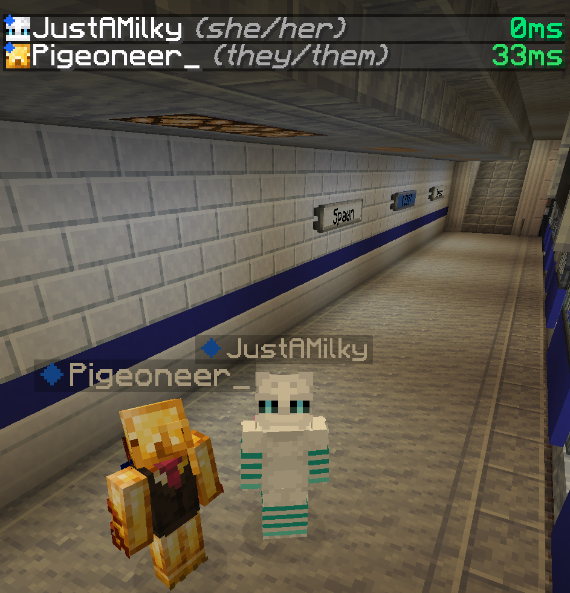

# pronoun-mod
Server-side Minecraft mod that allows players to display their pronouns next to their username.



## Commands
Pronoun Mod uses the `/pronoun` command for all player interaction.


### set
```
pronouns set <pronouns>
```
Sets the executor's pronouns to be displayed. This is stored in the world data.

### clear
```
pronouns clear
```
Clears the executor's pronoun display.

### setother
```
pronouns setother <player> <pronouns>
```
Available to permission level 1 and above. Moderator tool to set any player's pronouns.

### clearother
```
pronouns clearother <player>
```

Available to permission level 1 and above. Moderator tool to clear any player's pronouns.

## Features
### Current
- Pronoun display in the tab menu
- Commands to manage pronoun display
- Moderator tools to manage any player's pronoun display

### Planned
- Pronoun display in chat
- Pronoun display in name tags
- Player settings to locally disable certain pronoun displays
